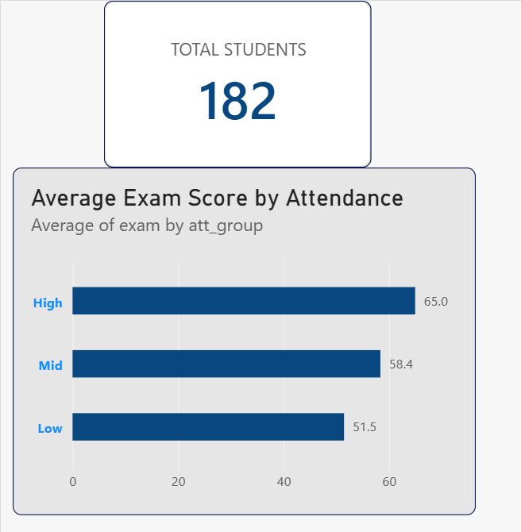

# Student Performance Analysis

A beginner-friendly Python and pandas ETL project that cleans fictional student records and summarizes performance by attendance group.

## Features

- Normalizes hours, percentages, and scores expressed with units.
- Removes duplicate records and invalid or missing attendance/exam values.
- Treats invalid optional measurements as missing.
- Assigns grades and attendance groups.
- Exports cleaned records, group summaries, and measurement correlations.

## Run on Windows

Requires Python 3.10 or later.

```powershell
python -m venv .venv
.\.venv\Scripts\python.exe -m pip install -r requirements.txt
.\.venv\Scripts\python.exe student_pipeline.py
```

On macOS/Linux, use `.venv/bin/python` instead of `.venv\Scripts\python.exe`.
Keep the script and input CSV in the same directory.

## Files

| File | Purpose |
| --- | --- |
| student_pipeline.py | ETL pipeline |
| student_performance_messy.csv | 200 fictional input records |
| requirements.txt | Python dependency |
| clean_students.csv | Generated cleaned dataset |
| analysis_results.csv | Generated attendance-group metrics |
| correlations.csv | Generated measurement correlations |

The sample produces 182 cleaned records after removing 10 duplicate records and 8 records with invalid/missing attendance or exam values. Output CSV files are recreated on each run and are excluded from version control.

Grades: below 50 = Needs Improvement; 50 to below 80 = Good; 80 to 100 = Excellent.
Attendance: 0 to 75 = Low; above 75 to 90 = Mid; above 90 to 100 = High.

Averages exclude missing measurements. Correlations exclude student IDs and use available measurement pairs. Correlation does not establish causation. All data is synthetic and intended for learning.

## Power BI report



[Download the Power BI report](powerbi/student_performance_dashboard.pbix) and open it in Power BI Desktop. On GitHub, use **Download raw file** on the report file page to save the binary report.

The report shows:

- **182 total students** in the cleaned sample.
- **Average exam score by attendance:** High 65.0, Mid 58.4, Low 51.5 (rounded to one decimal place).

These results describe fictional sample data, not real student outcomes.

### Refresh with your local CSV

1. Run the Python pipeline to generate `clean_students.csv`.
2. Open `powerbi/student_performance_dashboard.pbix` in Power BI Desktop.
3. If the saved source path is unavailable, use **File > Options and settings > Data source settings** to select the CSV source and **Change Source** to your local `clean_students.csv`.
4. Select **Refresh**, then save the report.

Power BI is optional; the Python pipeline runs independently. The screenshot is a static preview of the saved report.
